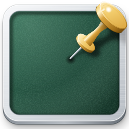
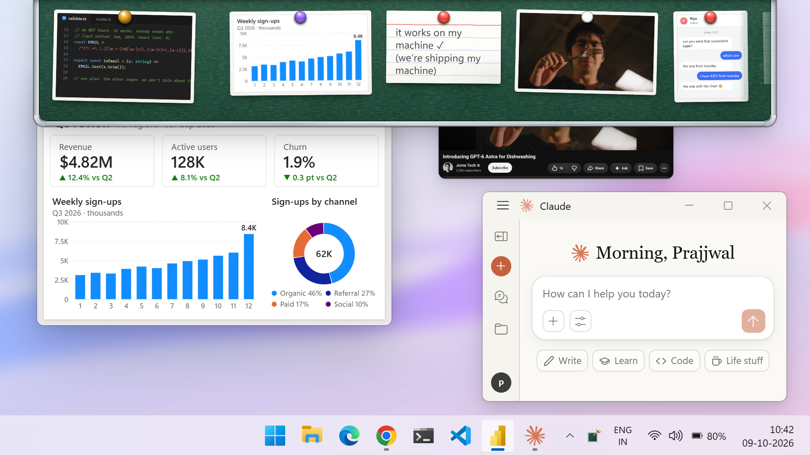
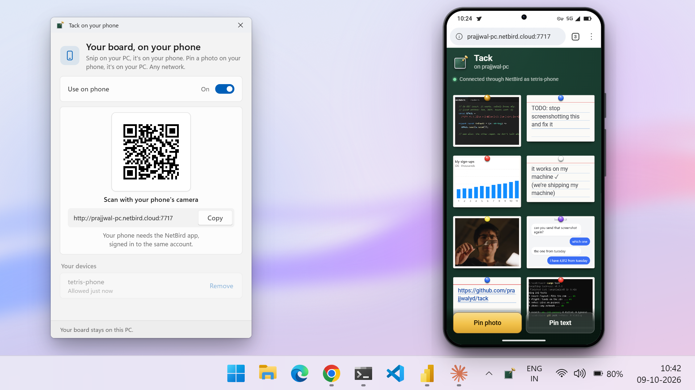

  

<h1 align="center">Snip it. It’s tacked.</h1>

<b>The top of your screen, finally useful.</b> 
Tack is a small pinboard for Windows that hangs just above the top edge of your screen.

https://github.com/user-attachments/assets/0e2f1078-f804-4241-9b8f-a8305564e11d

- **Snip the way you already do.** Win + Shift + S, Print Screen, or any tool
  that saves to your Screenshots folder. The board drops down, pins it, and
  tucks away again.
- **Get it back in a flick.** Push the pointer against the middle of the top
  edge, or press **Win + Alt + S**. Pick how quick it is: Instant, Normal or Slow.
- **Use it anywhere.** Click to copy, drag it straight into a chat or email,
  double-click to open, press and hold to edit.
- **Pin text on purpose.** Select something and press **Win + Alt + C**.
- **No clutter.** Old snips fade out after a week. **Keep** the ones you need.

  

## Your board, on your phone

Snip on your PC and it's in your pocket. Snap a photo on your phone and it
lands on your PC's board a second later. It works on Wi-Fi, on mobile data,
anywhere, with no cloud in between: your phone talks straight to your PC
through [NetBird](https://netbird.io), a free, open-source private network.

1. Install [NetBird](https://docs.netbird.io/get-started/install) on your PC
   and your phone, and sign in to the same account on both.
2. In Tack's tray menu, choose **Use on your phone…** and switch it on.
3. Scan the QR code with your phone and click **Allow** on your PC.

  

Add it to your home screen and it's one tap from then on. Only devices you
allow get in, and your board never leaves your PC.

## Make it yours

Open **Settings** from the tray icon. Choose the felt colour (or match your
Windows accent), the frame finish, the paper your notes are written on, and how
fast the board moves. Shortcuts, the phone link and updates live there too.

## Shortcuts

| | |
|---|---|
| **Win + Alt + S** | Show or hide the board. Arrow keys move, **Enter** copies, **Esc** closes. |
| **Win + Alt + C** | Pin what's selected: text, a link or a picture. |
| **Click** | Copy |
| **Double-click** | Open |
| **Press and hold** | Edit |
| **Drag** | Drop it into any app as a file |
| **Right-click** | Keep, Unpin, Show in Explorer and more |

Both shortcuts can be changed in Settings, under **Shortcuts** (the tray menu's **Shortcuts…** goes there).

## Private by design

- Your board stays on your PC. Tack only goes online to ask GitHub whether a
  new version exists (once when it starts, and when you press Check for
  updates; you can turn the check at start off in Settings), and to download
  one when you choose to install it. Updates are signed, and Tack refuses any
  that aren't.
- Text is never read from your clipboard on its own, only when you press
  Win + Alt + C, and your clipboard is put back as it was.
- Nothing is deleted for good: Tack's own copies go to the Recycle Bin.

The details are in [docs/privacy.md](docs/privacy.md).

## Install

1. Download **Tack_…_x64-setup.exe** (or **…_arm64-setup.exe** on an ARM PC) from the [latest release](https://github.com/prajjwalyd/tack/releases/latest).
2. Open it. Windows may say **"Windows protected your PC"**, because the installer isn't code-signed yet: click **More info**, then **Run anyway**.
3. Tack appears at the top of your screen, and its icon sits in the tray.

Tack updates itself: when a new version is out, Settings offers it, and one
click installs it. Your board stays as it was.

Windows 11.

To build it yourself, see [docs/development.md](docs/development.md).

## Credits

Inspired by [Tendedero](https://github.com/alejandrobujan/tendedero) by Alejandro Buján.
Built with C#, [WinUI 3](https://learn.microsoft.com/windows/apps/winui/winui3/) and .NET.

## License

MIT. See [LICENSE](LICENSE).
